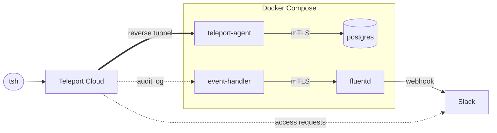
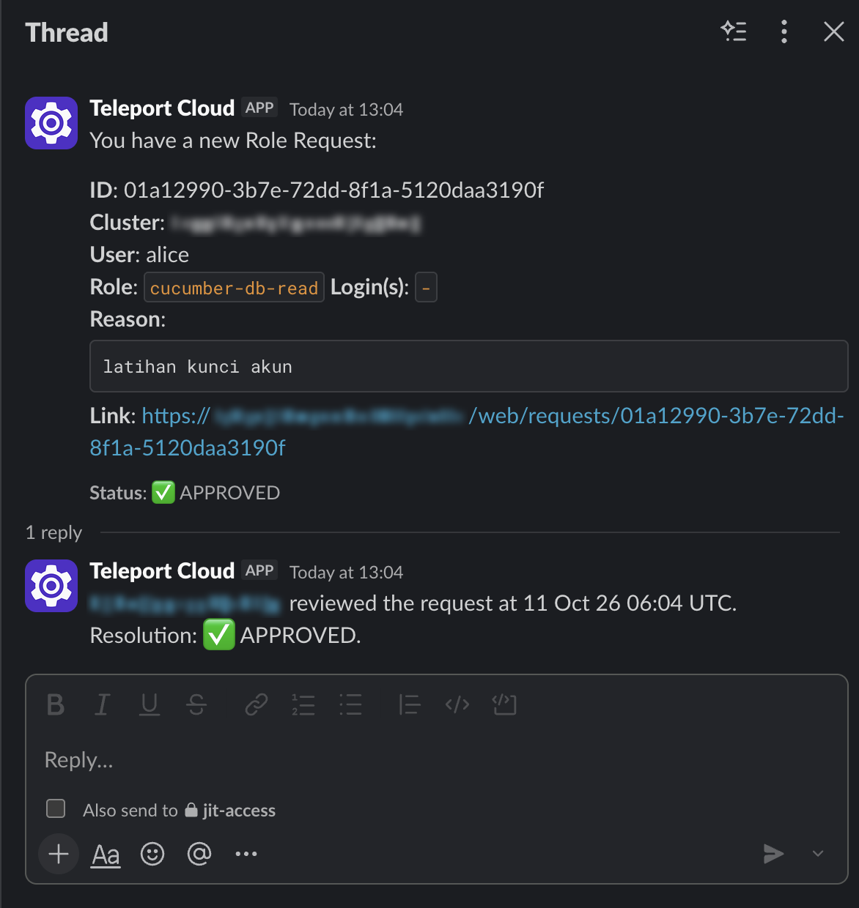
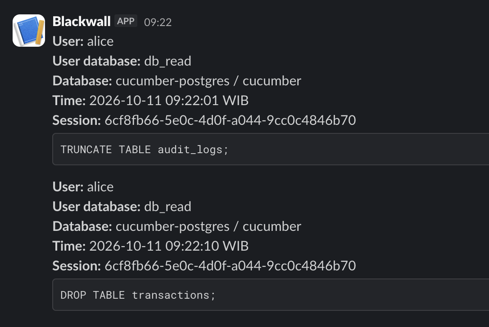
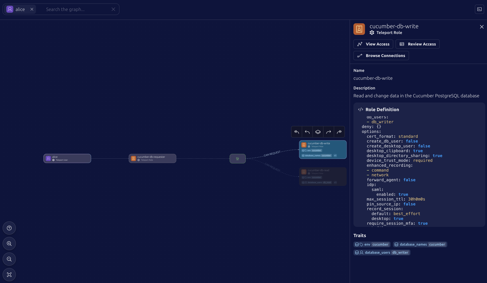

# Teleport JIT Database Access

Just-in-time, device-bound access to PostgreSQL through
[Teleport](https://goteleport.com), with Slack alerts on risky queries and
security events. All Teleport configuration is Terraform.

Built on a Teleport Enterprise Cloud trial, with PostgreSQL in Docker.
Resources carry the codename `cucumber`.

## What it does

- **No direct path to the database.** Postgres publishes no ports and accepts
  only client certificates issued by Teleport.
- **Just-in-time access.** Users request a role with a reason, reviewers are
  notified in Slack, and approved access expires after an hour.
- **Separate read and write roles**, each mapped to its own Postgres user.
- **Trusted device and per-session MFA.** Every connection needs an enrolled
  device and a WebAuthn check such as Touch ID.
- **Alerts on risky queries**: statements that change data, structure or
  privileges, run code, or copy data out.
- **Alerts on security events**: failed logins, denied database connections,
  and changes to MFA devices, roles, users and access lists.
- **Incident response.** Locking a user cuts live sessions; the audit log and
  session recordings give the timeline.

## Architecture



## Screenshots

| Access request approved | Risky-query alert |
|---|---|
|  |  |

Access graph: `alice` holds only the requester role, which can request the
read or write role.



## Layout

| Path | Contents |
|---|---|
| `terraform/` | Roles, access lists, users, database, tokens, bot, trusted devices, notification rule |
| `docker-compose.yml` | `postgres`, `teleport-agent`, `tbot`, `event-handler`, `fluentd` |
| `postgres/` | `pg_hba.conf`, schema and sample data |
| `teleport/` | Config templates for the agent, bot and event handler |
| `fluentd/` | Alert rules for queries (`fluent.conf`) and security events (`plugins/filter_security_alert.rb`) |

## Getting started

Requires `tsh` and `tctl` 18, Terraform, Docker, and a Teleport Enterprise
cluster.

```sh
cp terraform/terraform.tfvars.example terraform/terraform.tfvars   # fill in
tsh login --proxy=<tenant>.teleport.sh --user=<admin>
cd terraform
terraform init
eval "$(tctl terraform env)"
terraform apply
cd .. && docker compose up -d
```

`terraform apply` also writes the files Compose mounts: configs, certificates
and tokens. All of them are gitignored.

Steps Terraform cannot do:

- Enroll the Slack integration in the Teleport web UI (Integrations → Slack).
- Create a Slack incoming webhook for alerts and put its URL in `terraform.tfvars`.
- Enroll each device on the device itself: `tsh device enroll --current-device`.
- Set a password and MFA device for new users: `tctl users reset <name>`.

## Usage

```sh
# Standing access
tsh db connect cucumber-postgres --db-user=db_read --db-name=cucumber

# Just-in-time access
tsh request create --roles=cucumber-db-read --reason="..."
```

For write access, use `db_writer` and `cucumber-db-write`.

| To change | Edit |
|---|---|
| Who may request access | `jit_users` in `terraform/main.tf` |
| Who approves | `db_reviewers` in `terraform/main.tf` |
| How long access lasts | `max_duration` in `terraform/access_requests.tf` |
| Which queries alert | The regex in `fluentd/fluent.conf` |
| Which events alert | `EVENTS` in `fluentd/plugins/filter_security_alert.rb` and `types` in `teleport/event-handler.toml.tftpl` |

## Incident response

```sh
# 1. Lock the user. Live database sessions drop at once (0.2 s when tested).
tctl lock --user=<name> --message="<reason>" --ttl=8h

# 2. Build the timeline from the audit log.
tctl audit query exec --days=7 "select time, success, method, error from user_login where \"user\" = '<name>' order by time"

# 3. See the result of each query in the session recording.
tsh play --format=json <session-id>
```

The session ID is in the Slack alert. A lock only suspends: once removed, an
approved request works again until it expires.

## Limitations

- Alerts match statement text, so a large `SELECT` is not flagged.
- Alerts do not say whether a query succeeded; only the session recording does.
- Alerts can lag the event by one to two minutes.
- Sessions are not cut when just-in-time access expires.
- Locking and unlocking a user raises no alert.

## Edition

Access lists, Trusted Devices, the reviewer role, the hosted Slack
integration, notification routing rules and `tctl audit query` are Teleport
Enterprise features. Database access, per-session MFA, the audit log, session
recording and the alert pipeline also work on Community Edition.
